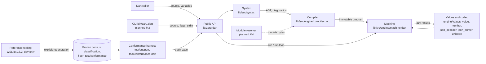

# zaru Architecture

The current system shape. Change designs read this first. Detail lives in the
ADRs (`docs/adr/`) and in change designs: the archived
[implement-core-language design](changes/archive/2026-11-01-implement-core-language/design.md)
holds the binding detail behind M1 (D1-D9). One exception: D3's rule that
`try` never catches `break` is scheduled for reversal by M2's first change
(`catchable-break`) to match jq 1.8.2, so new designs must not build on it.
Planned components are marked *planned* and are not claimed as implemented.

## System triage

- **T1 Components: applies.** There are five library components (public API,
  syntax, compiler, machine, values and codec), plus the conformance harness,
  the reference tooling and the CLI, with directed
  compile → execute → export flows.
- **T2 State: applies.** There is no runtime persistence, but checked-in frozen
  state (reference census, classification, passed-ID floor) governs acceptance.
  Each compiled filter and iterator has its own private state.
- **T3 Concurrency: does not apply.** Evaluation is synchronous lazy iteration
  with no isolates, timers or async pipelines. Module loading stays synchronous
  (ADR 0005).
- **T4 Boundaries: applies.** The public Dart API, jq JSON text in and out, jq
  diagnostic text, the CLI flags and exit codes (*planned*, M3), the
  module-resolver contract (*planned*, M4) and the CI context names.
- **T5 Volume: applies.** Inputs, generators, recursion depth, programs and
  diagnostics can grow without limit, so each has an explicit bound (below).
- **T6 Risk: applies.** Library callers may run untrusted filters and JSON
  input, which makes resource exhaustion and host access the risk surface. ADR
  0004 keeps host access caller-granted. zaru does not bound a filter's CPU,
  time or memory. Callers running untrusted filters must isolate them (in an
  isolate or worker) and own cancellation. An opt-in step budget is not built;
  adding one later would be additive.

## Components

| Component | Responsibility | Owns (state) | Talks to via (contract) |
|---|---|---|---|
| Public API (`lib/zaru.dart`, `filter.dart`, `errors.dart`) | `Zaru.compile`, `ZaruFilter.run`/`runJson`, `Zaru.toJson` and the typed errors | Nothing beyond the compiled filter it returns | Callers through `docs/api.md` (ADR 0003 numbers) |
| Syntax (`lib/src/syntax`) | Lexer with spans, Pratt and recursive-descent parser, jq-identical diagnostics and depth guard | One compilation's tokens and AST | Compiler through the private AST (ADR 0001) |
| Compiler (`lib/src/engine/compiler.dart`, `builtin_names.dart`, `jq_builtins.dart`) | Lexical resolution, verbatim `builtin.jq` helpers, lowering into executable nodes, unsupported versus semantic classification | The immutable program and its definition tables | Machine through private nodes (ADR 0002) |
| Machine (`lib/src/engine/machine.dart`) | Lazy generator execution, backtracking, label and catch handling, path mode (*planned*, M2) | Per-iterator frames, continuations and accumulators | Codec through the private value model |
| Values and codec (`engine/values.dart`, `value.dart`, `number.dart`, `json_decoder.dart`, `json_printer.dart`, `unicode.dart`) | Origin-aware values, native ingestion and export, the jq JSON parser and printer, Unicode rules | Node-owned public projection memos | Public API (ADR 0003, D4/D7/D8) |
| Conformance harness (`test/support`, `test/conformance`, `tool/conformance.dart`) | Runs all 781 pinned cases, compares strictly, writes the report and gates | The generated report (`build/`) | The public API only; never runs jq |
| Reference tooling (`mise run reference-*`) | Builds pinned jq 1.8.2 under WSL, regenerates and verifies the census and classification | Checked-in reference data, only by explicit command | Native jq; never run by tests or CI |
| CLI (`bin/zaru.dart`), *`--version` only today* | jq-compatible command line from M3. Option parsing and output policy can live in `lib/` without `dart:io`, with `bin/` as the thin host entrypoint. A single pubspec means no `package:args` (zero runtime dependencies) | Process I/O | The public API plus host capabilities (ADR 0004) |
| Module resolver, *planned M4* | Supplies module bytes; jq's path rules live in `lib/` | Nothing (caller-owned); the compiled filter keeps a reference for `modulemeta` and `get_search_list` | `ZaruModuleResolver` (ADR 0005) |

## State ownership

| State | Sole writer | Lifetime | Invalidation / rebuild | Authoritative copy |
|---|---|---|---|---|
| Tokens, AST, diagnostics | One `compile` call | That call; a failed compile surfaces them in the error | A new compile | The source text |
| Compiled program and definitions | Compiler, immutable afterwards | The `ZaruFilter` | A new compile | The compiled filter |
| Lexical frames, continuations, accumulators | One iterator | Until the iterator is exhausted, fails or is dropped | Never reused; a new run starts fresh | The iterator |
| Public projection memo | Its immutable internal node | Reachability of that node | None needed: changed values get new nodes | The memo on the node (no global table) |
| Pinned corpus (`jq.test`, `man.test`) | Upstream, vendored byte-for-byte | Pinned to jq 1.8.2 | Only a deliberate re-pin with provenance | `test/conformance` plus `PROVENANCE.json` |
| Reference census and classification | `mise run reference-census` / `reference-classification` after review | Across milestones | Explicit regeneration and `reference-freeze`; never from a zaru result | Checked-in files with integrity digests |
| Passed-ID floor | A reviewed change adding newly measured passes | Across milestones | Grows only; losing an ID fails the gate | `test/conformance/floor.json` |
| Conformance report | `mise run conformance` | Until the next run | Regenerated on every run | `build/conformance-report.json` (not source) |

## Boundaries and contracts

- **Dart API:** documented in `docs/api.md`. It is pre-1.0 now, and becomes
  semver-bound at 1.0. Changes go together with `docs/api.md`, the tests and
  the CHANGELOG.
- **Values:** plain JSON-shaped Dart values plus `ZaruNumber` (ADR 0003).
  Engine-created containers are immutable.
- **JSON text:** jq 1.8.2's `jv_parse` input grammar and `jv_print` output
  (D7/D8).
- **Diagnostics:** jq 1.8.2's message text, excerpts and carets, within
  documented resource bounds.
- **Corpus and reference:** pinned by `test/conformance/VERSION` and
  `PROVENANCE.json`, protected by integrity digests, and verified by
  `mise run reference-verify`.
- **Host capabilities:** environment, inputs, message sinks, clock and module
  resolver are passed explicitly (ADR 0004, ADR 0005).
- **CLI (*planned*, M3):** jq 1.8.2's documented options, exit codes and
  stdout/stderr split.
- **CI:** the context names `checks`, `core-dart2js`, `core-dart2wasm`,
  `conformance-gate`, `full-conformance` and the three `Compile CLI (...)`
  jobs (D9, AGENTS.md).

## Resource bounds and failure visibility

| Flow / store | Bound | At the bound | On failure | Who finds out |
|---|---|---|---|---|
| Program syntax depth | 256 levels; pipe and comma chains don't count | Typed `ZaruCompileError` | No filter is produced | Caller |
| Compile diagnostics | 1 MiB rendered in total, 240-byte excerpt window | Summary "N more diagnostics omitted" | Reports within the budget are byte-identical to jq's | Caller |
| JSON input nesting | jq's 10000 parser slots (object keys count) | `FormatException` with jq's message | Iterator becomes terminal | Caller |
| Printing depth | 10000 | jq's `<skipped: too deep>` marker | Output may be non-JSON, as in jq | Caller |
| Equality, ordering, object merge depth | 10000 | jq's typed runtime error | Catchable; inputs unchanged | Consumer or `catch` |
| String repetition | jq's result-size limit | Typed runtime error before allocation | Catchable | Consumer or `catch` |
| Generators and recursion | Active frames only; no output cap. Collecting forms (`[...]`, `reduce`, `sort`) run to completion inside one pull, with no CPU, time or memory bound | Consumer stops pulling between results; there is no cancellation inside a pull | Host memory exhaustion is never reported as a jq success | Consumer, which isolates untrusted filters |
| Module linking (*planned*, M4) | Each normalised code-module path loads once; linking depth is bounded by the number of distinct paths the resolver supplies; data modules load per import | jq's `circular import` error before any recursion | Typed compile error; resolver exceptions propagate unchanged | Caller |
| CLI input stream (*planned*, M3) | One JSON value at a time unless `--slurp` | Not applicable | jq's exit code and stderr | Shell user |
| Conformance run | 781 fixed cases, compared incrementally | Not applicable | Red report or gate | CI and contributor |

## In-force ADRs

| ADR | Decision | Supersedes |
|---|---|---|
| [0001](../docs/adr/0001-parser-strategy.md) | Hand-written lexer and Pratt/recursive-descent parser with spans and preserved literals | — |
| [0002](../docs/adr/0002-evaluation-model.md) | Lazy closure-tree evaluation with per-traversal state and path-aware updates (numeric proposal superseded) | — |
| [0003](../docs/adr/0003-numeric-boundary.md) | Exact numbers at the jq boundary: plain values plus narrow `ZaruNumber` | ADR 0002's numeric proposal |
| [0004](../docs/adr/0004-pure-core-host-edges.md) | Pure library core; host I/O through explicit synchronous capabilities | none |
| [0005](../docs/adr/0005-module-resolution.md) | Caller-supplied synchronous module resolver; jq path rules in `lib/` | none |
