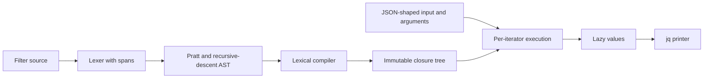
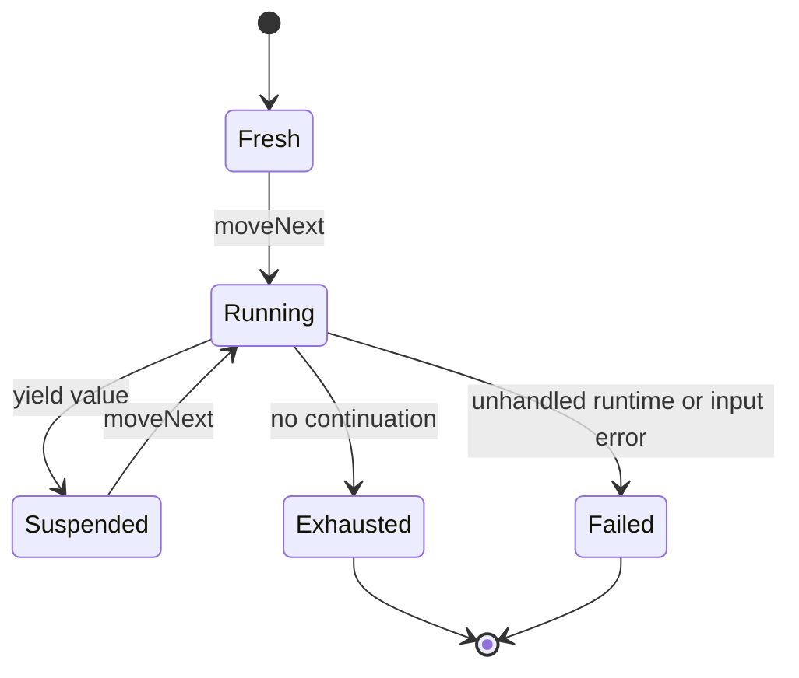
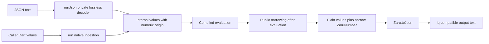

# Design

## Triage

| Trigger | Applies? | Evidence |
|---|---|---|
| T1 Components | Yes | `lib/zaru.dart:1-5` has no engine; M1 introduces lexer → AST → compiler → runtime/printer. |
| T2 State | Yes | Lazy iterators need fresh/running/suspended/exhausted/failed states and per-run lexical frames. |
| T3 Concurrency | No | Evaluation is synchronous; callers may interleave independent iterators, but no worker, timer, retry, or asynchronous pipeline is introduced. |
| T4 Boundaries | Yes | `docs/api.md:9-33` specifies a new public API; `test/conformance/fixtures.dart:19-64` preserves upstream raw numeric JSON. |
| T5 Volume | Yes | `range`, `repeat`, recursion, and comma/pipe products have no fixed result bound. |
| T6 Risk | Yes | Rounding untouched numeric IDs changes user data; `docs/adr/0002-evaluation-model.md:32-46` identifies this boundary. |

TIER: FULL

## Context

M0 is complete on main at `c56b9a8`. The library entrypoint is empty (`lib/zaru.dart:1-5`); the runner deliberately fails each fixture (`test/conformance/runner_test.dart:77-91`). There is no lexer, parser, compiler, or runtime in the inspected `lib/` tree. Existing pure-Dart fixture parsing and 27 VM/Chrome infrastructure tests are reusable. Scope is in proposal.md and its three delta specifications, not a CLI implementation.

The installed jq is 1.8.2. Reference invocations confirmed filter/value parameter composition, lazy `first`, false/null alternative filtering, partial results before catch, and `error(null)` raising an error whose catch value is null. Numeric reference output preserves `1.00`, renders `1e2` as `1E+2`, and prints computed `1.0 + 0` as `1`. Literal fidelity means jq-normalized spelling, not blindly copying every source byte.

The architecture index configured as `openspec/architecture.md` does not exist; both existing ADRs were read directly. No referenced stores are configured. The user explicitly approved the narrow exact-number type after the VM smoke check could not represent `12345678909876543212345` as an int and rounded it as a double.

## Decisions

### D1: Compile a real jq AST into lazy executable nodes

- **Choice:** Follow ADR 0001's source-span lexer, Pratt binding-power table, and recursive-descent structured productions. Before runtime work, inventory every pinned parser.y/lexer.l production and both fixture corpora: original M1 forms are in scope; `$__loc__`, format operations, assignment/update operators, and module loading retain their explicit later-milestone dependencies. Recognize deferred syntax for classification without implementing fake semantics. Cover optional else, keyword-named keys/fields, destructuring alternatives, and reduce/foreach arities. Lower jq-defined M1 helpers and their minimal dependencies from pinned source; implement only necessary native primitives.
- **Rejected:** A bytecode VM adds instruction design and dispatch before a measured need; interpreting source fragments on each run repeats parsing and makes compile errors lazy.
- **Reversal cost:** Medium. Internal node and closure representations are private; public errors and lazy stream ordering must remain stable.

### D2: Give every run and iterator its own execution state

- **Choice:** Compiled nodes and definition tables are immutable. Every iterator owns its lexical frames, continuation stack, branch positions, and reducer/foreach accumulators. Filter arguments capture call-site environments; bodies retain definition scope and invocation input. `$param` lowers to value binding. Comma RHS, pipe RHS, and conditional result branches are tail positions: replace completed frames when no sibling work remains, retaining genuinely pending alternatives only. Ported repeat/while/range/3/until therefore do not grow a host call stack or retain one frame per completed step. Recursive descent uses traversal-depth frames, not a result list.
- **Rejected:** Mutable variables on the compiled filter would leak bindings between inputs and interleaved iterators. Eager list-based node evaluation cannot stop before an error in an unused branch.
- **Reversal cost:** Medium. Per-run ownership is binding; the private continuation mechanism can change without changing the API.

### D3: Use typed data errors and separate lexical control signals

- **Choice:** Internally keep a diagnostic record with kind, message, source, and UTF-8 byte-offset start/exclusive-end span. Public `ZaruCompileError` exposes first-diagnostic line/col/endLine/endCol/message and immutable ordered rendered `diagnostics`; jq's diagnostic-location conventions, including EOF, govern those coordinates. A pure-Dart renderer reproduces pinned jq callback messages, four-space excerpts, and span-width carets. The conformance adapter selects the last block prefixed `jq: error`, as test_err_cb does, then applies jq_test.c's line-prefix policy; the public first diagnostic remains unchanged.
- **Choice:** A grammar-context/unexpected-token/expected-token compatibility table reproduces jq's Bison-style token labels and expectation sets for the implemented grammar. It is keyed by grammar state, never fixture ID or complete source text. Implement the relevant Bison `error` recovery productions, not just the first parse failure: `{1+2:3}` reports an initial syntax error and then the parentheses diagnostic. Lexer and constant-key semantic errors have explicit renderer coverage. No M1 diagnostic mismatch is silently reclassified out of acceptance.
- **Choice:** Runtime errors retain the actual jq error value, including null; catch nodes intercept only data errors. Private break signals carry a unique lexical label identity and unwind only to that label. An unsupported-construct compile category remains distinct from supported semantic errors and cannot satisfy any expected-error fixture. Host exceptions are never translated into successful jq execution. Failed iterators are terminal on subsequent moveNext.
- **Rejected:** A single exception class for compile failures, runtime data, and break would let `try` swallow lexical control flow and inflate expected-error fixture passes.
- **Reversal cost:** High for public error contracts; the distinction is required by pinned label/catch fixtures and the user brief.

### D4: Preserve exceptional numbers through an explicit narrow boundary

- **Choice:** The public boundary and automatic final-output classification are specified in filter-execution: ordinary values stay plain; final ZaruNumber exposes only parse/literal/toDouble/toString/equality/hashCode and is not num or Comparable. Explicit parse constructs a wrapper; final output may narrow it. Accept scalar wrappers at root, nested and argument boundaries without promising their Dart identity. Container projection identity is separately specified in D8.
- **Representation:** Keep sign, coefficient digits, decimal exponent/scale, canonical literal text, and literal-versus-computed origin privately. Preserve scale in `.literal`; normalize coefficient/exponent separately for wrapper equality and hashing, including equivalent zeros. Do not pad an exponent-sized string or allocate a huge BigInt merely to classify/compare/hash it. Public equality compares wrappers only, not native num, and is distinct from jq evaluator equality.
- **Canonicalization:** Follow pinned decNumberFromString context and decNumberToString without trimming, not Dart formatting: `100e-2` retains `1.00`; large exponents remain scientific strings. Follow the pinned parser's decimal context limits: tokens normalized to infinity become internal nonfinite values and export as native doubles; the finite-only wrapper parser rejects such results. Native mathematical values cannot restore a spelling or digits lost before the API call.
- **Conversion:** Literal-to-double mirrors jvp_literal_number_to_double: DEC_INIT_DECIMAL64-derived context, 17 significant digits, its half-even reduction and context exponent limits, then correctly rounded binary64 conversion. Direct double.parse is not a substitute. Unary negation preserves literal precision and follows jq's literal-zero canonicalization (negating literal zero yields positive zero); computed negation follows binary64 signed-zero behavior. Binary arithmetic produces computed origin. Literal/literal comparison is decimal; mixed/computed comparison uses jq's double fallback.
- **Native ingestion/export:** Every finite native value exactly representable as binary64 enters as a jq computed number, keeps signed zero, and exports as plain num under identity. Only a native integer whose exact binary64 round-trip fails gets exact literal origin and the literal export rule. The decision is numeric, never based on Dart spelling or int-versus-double subtype. No expanded integer coefficient is invented for native 1e23/1e300. Nonfinite natives keep their number kind. Explicit wrappers retain literal origin and can narrow on output if eligible; object identity is not promised.
- **Lossless text execution:** `filter.runJson(String, {Map<String, Object?> args = const {}})` lazily decodes one jq JSON value on first moveNext into private origin-bearing values, then evaluates before public narrowing. The native run API stays primary for Dart data; runJson is the direct JSON-text entry for conformance and later CLI inputs. There is no public fromJson in M1: decoding to ordinary public num and re-ingesting it would erase literal origin even for 42 (`42 == 42.0000000000000001` is false, but computed 42 compares true). This replaces the earlier unimplemented decoder proposal, not an existing API. Explicit ZaruNumber provides caller-selected literal origin in native root/nested/argument values.
- **Three comparisons:** The evaluator follows jq's origin-aware comparison. The fixture oracle compares finite numbers as exact decimal coefficient/exponent values, representing computed doubles through jq's shortest-round-trip printer, not expanded binary fractions. Nonfinite values are compared before printing under pinned jv_equal behavior; NaN cannot match null and infinity cannot match the clamped finite maximum. Text, including tojson results and diagnostics, is never numerically normalized.
- **Rejected:** Converting internal literals to public num before evaluation loses origin; a numeric-value side table conflates origins and spellings. Wrapping every public scalar violates the approved narrow boundary. A text-only API would remove the requested native-value API; therefore both native run and direct runJson are supported, with explicit ingestion semantics.
- **Plain-number types:** Eligible safe integral literals export as int except negative zero; other plain literals export as double. Newly computed arithmetic results use double on VM and wasm. Compatible native pass-through retains its original num subtype/storage, avoiding pointless copies of ordinary caller trees. Only dart2js has overlapping numeric subtypes; VM and wasm have distinct int/double and can enter the exact-native-integer branch. Host subtype never changes jq numeric comparison/arithmetic.
- **Composition:** A public num re-entering run is computed and loses former literal origin. A single compiled jq pipe preserves all internal origins. For finite literal results within printer limits, toJson/runJson preserves literal value/spelling, not computed origin, nonfinite numbers or over-depth values. Native args use the native rule; M3 --argjson/--slurpfile must use a private decoder-to-environment path before public narrowing.
- **Reversal cost:** High. The user approved the boundary; classification, accessors, hashing, accepted input types, native origin, and conversion behavior are pinned before export rather than delegated to an implementer's later preference.

### D5: Separate external variable declarations from per-run values

- **Choice:** Refine compilation as `Zaru.compile(String, {Set<String> variables = const {}})`. Lexical bindings and declared external names resolve at compile time; run/runJson arguments supply values per execution. On each iterator's first moveNext, missing declared bindings produce a typed runtime argument error before any filter output; run/iterator creation stays lazy. Undeclared references remain jq compile errors. No run's values are captured into the reusable compiled filter.
- **Rejected:** Treating every unknown `$name` as an external variable would make jq's undefined-variable compile-error fixtures pass compilation. Capturing argument values only at compilation would undermine reuse with per-run `args`.
- **Reversal cost:** Medium. This is a refinement of the provided sketch, not a new query/context abstraction.

### D6: Replace artificial failures with strict execution, not broad skipping

- **Choice:** Keep fixture raw text, source-line IDs, denominator, and report path. Before any zaru evaluator runs, freeze grammar/builtin dependencies for all 781 cases across jq.test and man.test; reclassification requires a reviewed concrete dependency, never a failing zaru result. Core syntax-message fixtures remain mandatory. A source-only unknown name is not automatically an M2 builtin: distinguish jq's actual deferred builtin catalogue from the core undefined-name error.
- **Reference prerequisite:** A separate mise-managed reference-census command captures all cases once with the verified pinned jq binary and complete pinned driver assets/environment. Record binary/version/source/command/environment provenance, output prefix, compile diagnostics, terminal kind and catchable error value per ID. Primary execution leaves source unchanged; secondary tagged capture requires prefix verification and preserved imports/prologues, line counts and module context. Missing assets, changed observations, crashes or uncertainty fail generation rather than becoming expectations. Check in complete payloads with integrity hashes and ID coverage before any engine runs; regenerate only by explicit command and review.
- **Terminal policy:** Four proven anchors are jq.test:945/949/953/957, which emit no values and raise `Cannot index array with string ("a")`; their comments incorrectly mention `"c"` and remain non-executable. They are anchors, not a claimed exhaustive list. The census covers normal-empty cases and nonempty prefixes followed by errors. Zaru must match both expected prefix and recorded typed termination; early/wrong/host errors and extra results fail. Record `not observed` rather than fabricated terminal state when comparison abandons a mismatching iterator.
- **Execution/diagnostics:** Replace the M0 artificial failure path completely. Decode directly into private values as runJson does, invoke the real compiler/evaluator, and apply D4's value/text distinction without intermediate public numeric narrowing. Reproduce pinned %%FAIL last-jq-error callback selection and prefix matching. IGNORE MSG ignores only text equality, not unsupported cause. Required dependencies must exist before a compile-error case can pass; an early unsupported import cannot manufacture a module-syntax-error pass.
- **Two zaru commands:** conformance and conformance-gate each validate checked-in reference hashes/provenance/781-ID coverage and freshly execute every case with shared comparison code, never native jq or reference regeneration. Full conformance fails for any failure; the gate requires complete accounting plus M1/floor passes, not stale reports. Move full conformance out of checks into standalone full-conformance with unmasked failures. Checks, both browser compiler jobs, existing CLI compile jobs and the binary gate must be green for M1 acceptance. D9 names their status contexts and explicitly distinguishes milestone policy from GitHub branch protection; M1 does not change repository protections.
- **Rejected:** Dropping fixtures, interpreting comments as directives, accepting arbitrary terminal exceptions, weakening grammar diagnostics, or fitting acceptance to failures inflate compatibility. Count-only floors hide lost IDs. Stale report consumption makes a green gate untrustworthy.
- **Reversal cost:** Low for internal report shape; high for the meaning of passing. An updated baseline may add passing IDs but never remove a previous pass or silently alter a fixture.

### D7: Specify Unicode and nonfinite boundaries explicitly

- **Choice:** Implement code-point string slicing and unsigned UTF-8 comparison/key order. Numeric string indexing is a jq data error, not character access; optional indexing suppresses it. Slice bounds follow jq's negative/fractional normalization. Native ingestion performs D8's iterative projection-changing-path normalization; normalized key collisions keep the first insertion position and last value. Printing normalizes only visited strings/keys, never a depth-skipped subtree. Public length remains deferred to M2 unless needed by the frozen dependency inventory.
- **Choice:** runJson decodes one value using pinned jv_parse grammar, not RFC-only Dart jsonDecode: include BOM, +1/01/.5/1., and accepted NaN/infinity spellings. Raw unescaped lone UTF-16 units in the Dart source string normalize to U+FFFD like invalid UTF-8 at jq input. Escape decoding is distinct: a lone high-surrogate escape is invalid and a lone low-surrogate escape normalizes to U+FFFD. A malformed input raises FormatException on first moveNext and that iterator becomes terminal.
- **Choice:** Nonfinite input retains numeric kind internally and exports as native NaN/infinity, not finite-only ZaruNumber. The printer maps NaN to null and computed infinity to the signed maximum finite double; finite literals outside binary64 range keep their canonical form. A plain negative-zero double prints `-0` on every target. JSON input `-0` passes through as negative zero; compiled expression `-0` and negation of literal zero follow jq's separate positive-zero canonicalization. Unsupported non-JSON caller objects remain errors.
- **Rejected:** Dart substring/compareTo split astral code points or impose UTF-16 order; a generic host JSON decoder discards numeric digits and rejects jq-accepted input. Blanket rejection of nonfinite values contradicts jq's printer and corpus.
- **Reversal cost:** Medium. Encoding choices affect visible string values, ordering, diagnostics, and the public JSON boundary and therefore receive explicit cross-target scenarios.

### D8: Bound deep codec work and public projection reuse

- **Choice:** Decode, normalize, export and print with explicit work stacks. Reject a new JSON container at parser stackpos >=10000, counting containers and pending object-key slots: arrays around zero accept 10000/reject 10001, keyed objects accept 5000/reject 5001. FormatException.source is the original Dart String; offset is its zero-based UTF-16 failing-token index; message includes jq's reason and one-based line/UTF-8-byte column. Native/constructed values do not inherit the parser budget. Empty/whitespace input is a missing-value format error for this single-value API; M3 stdin is a separate zero-or-more-value stream.
- **Choice:** Match jv_print exactly: root depth is zero; a value at depth >10000 becomes literal unquoted `<skipped: too deep>`, without visiting or pre-normalizing its subtree. This deliberately may produce non-JSON text; document it as jq behavior, not successful lossless encoding. Compact boundary tests use native/constructed inputs, not rejected over-depth JSON text.
- **Choice:** Each immutable internal engine container owns a lazily initialized immutable public projection. Iterative export reuses already projected child nodes and memoizes at most one List/Map projection per internal node; unchanged public-compatible storage may be reused. Repeated yields of the same internal subtree expose the identical immutable public container. This is derived memo state, not mutable semantic content or iterator state. Caller-owned mutable containers are never memoized/frozen under this rule; scalar wrapper identity remains unspecified.
- **Native paths:** When native ingestion is needed, its single iterative pass rebuilds any path whose public projection differs into immutable engine nodes while preserving PRIVATE numeric origin: narrowable caller wrappers, nonrepresentable exact integers, and normalized strings/keys. It must not prematurely replace literal 42 with computed native 42. Unchanged public-compatible caller storage is reused as-is, without memoization/freezing or num-subtype conversion. Only rebuilt owned nodes get projection memos. This closes repeated-export costs for native inputs as well as decoded JSON.
- **Bound/lifetime:** First projection costs O(newly visited nodes/edges), uses O(active depth) work frames, and creates only necessary public containers. Later export of the same node is O(1); descent through shared subtrees does not reconvert them. Store the memo on the node, never in a run/global strong-key table that retains completed unique stream results. Memo lifetime is node reachability; compiled-template projections are bounded by template size, while discarded unique outputs add no retained stream-wide cache.
- **Rejected:** Recursive codecs fail below jq's limits on browsers; a uniform container nesting cap miscounts object keys. Per-yield deep conversion makes descent quadratic. A global strong-key projection map would leak a lazy stream. Lazy public wrapper hierarchies are unnecessary when ordinary immutable Dart List/Map projections suffice.
- **Reversal cost:** Medium for the repeated-container identity guarantee; low for internal work-stack layout. Scalar identities remain deliberately outside the public contract.

### D9: Make cross-target checks runnable without inventing repository policy

- **Choice:** Add web-test-wasm before group 2 needs it: its mise run value is `dart test test/unit -p chrome --compiler dart2wasm`; make existing web-test explicitly select dart2js. The locked test 1.33.0/test_core 0.6.21/test_api 0.7.15 source accepts --compiler and lists dart2wasm in Chrome's supported compilers. Run both existing scaffold unit suites once before engine work; install/select a compatible Chrome (currently 137+ for the pinned SDK family), not a silent default-compiler fallback.
- **CI policy:** Use exact job names/check-run contexts checks, core-dart2js, core-dart2wasm, conformance-gate and full-conformance; preserve existing Compile CLI (ubuntu-latest), Compile CLI (macos-latest) and Compile CLI (windows-latest). M1 acceptance requires every context except full-conformance green; the full report remains failed if any corpus case fails. Add both browser jobs early, split the corpus job during task 7.3, and record names/commands/roles in AGENTS.md.
- **Authority/evidence:** These are milestone requirements, NOT a claim of enforced GitHub merge protection. Read-only API inspection during this revision returned main protection 404 (Branch not protected) and no active branch rules. M1 does not create/change protection or rulesets; that would need a separate explicit user request and authorized API verification. Before renaming contexts, inspect live policy read-only and preserve any subsequently user-required names unless an explicit migration is authorized. Verify actual check-run names/results after CI, not YAML text alone.
- **Sources:** [Locked test release/docs](https://pub.dev/packages/test/versions/1.33.0), [Dart Wasm requirements](https://dart.dev/web/wasm), [GitHub protection API](https://docs.github.com/en/rest/branches/branch-protection), [active branch rules API](https://docs.github.com/en/rest/repos/rules).
- **Rejected:** Advertising wasm checks without a runnable task; calling jobs externally required just because YAML exists; silently changing account/repository policy to satisfy an invented enforcement promise.
- **Reversal cost:** Low for task implementation; medium for renaming public CI contexts once a user configures protections.

## Diagrams (FULL)

T1 — compile and execute components:

T2 — each independent iterator:

T4 — lossless numeric and public boundaries:

## State & Ownership (FULL)

| State | Owner (sole writer) | Lifetime | Invalidation / rebuild | Authoritative copy |
|---|---|---|---|---|
| Source/tokens/AST | One compilation | Compile call; source spans may be retained for errors | New compile call | Current compile input |
| Definitions and executable nodes | Compiler, then semantically immutable | Compiled filter | New compile call; derived projection caches do not change program meaning | Compiled filter |
| Lexical frames and continuations | Individual iterator | Consumption or disposal by reachability | New iterator, never reuse from failed run | Iterator |
| Reduce/foreach accumulators | Individual iterator | Current reduction branch | Rebuilt per branch/run | Current execution frame |
| Collection literal templates and engine-created containers | Compiler/runtime at creation, then immutable | Reachable value lifetime | Each changed value creates new containers; immutable children may share | Engine-created List/Map nodes |
| Public container projection memo | Its immutable internal node; exporter initializes once | Reachability of that node, bounded by compiled templates or live execution values | No semantic invalidation; changed values have new nodes | Cached immutable public List/Map, never a global or run-wide retention table |
| Caller-owned collection references | Caller | Caller-defined | Not snapshotted or frozen by identity/pass-through | Caller input; mutation during iteration is outside the snapshot guarantee |
| Literal metadata | Decoder/compiler at creation, then immutable | Reachable value lifetime | Unary negation retains exact metadata; binary arithmetic produces computed origin | Internal numeric value, not a side table keyed by native num |
| Expected fixtures | Parser, then immutable | Conformance process | Reparse unchanged fixture bytes | Vendored corpus |
| Actual case outcomes | Runner | One suite invocation | New invocation | Execution observations |
| Reference census and frozen two-corpus classification | Reference tool/reviewer before evaluator execution | Across the milestone | Regenerate only from pinned source/environment and review dependency changes | Complete checked-in baseline and acceptance manifest |
| Passed-case floor | Reviewed source change | Across milestones | Add observed passes; never remove IDs silently | Checked-in manifest |

## Failure & Visibility (FULL)

| Component | Fails / dies mid-operation → | Recovery | Retry safe? | Who finds out |
|---|---|---|---|---|
| Lexer/parser/compiler | No usable compiled filter is published | Correct source/declaration and recompile | Yes; compile has no effects | Caller receives typed location/diagnostic |
| JSON decoder | No partial public value is returned | Correct JSON and decode again | Yes | Caller receives a format failure with source position |
| Iterator | Earlier yields remain observed; unhandled jq error ends that iterator | Start another run; no implicit retry | Yes for pure M1 execution, but previously observed values are not retracted | Consumer sees typed runtime error |
| Label/catch handling | Only the matching language construct handles its signal | Resume remaining enclosing continuation | No retry mechanism | Observable stream/error matches jq |
| Printer | Unsupported non-JSON caller objects are errors; valid nonfinite numbers use D7's jq formatting | Correct unsupported caller data | Yes | Caller sees explicit unsupported-data error, never a false numeric error |
| Structural equality/order, recursive merge, repetition | A jq structural limit raises a typed, catchable runtime error before host-stack or excessive-size failure | Correct input/operation; start fresh iterator | Yes; input remains unchanged | Consumer/catch filter sees the pinned jq error value |
| Reference generation / zaru conformance / gate | Incomplete captures cannot publish a valid baseline; invalid baseline hashes/IDs, mismatched outcomes or lost passes fail the zaru run | Explicitly regenerate/review reference data when necessary, or fix zaru and rerun; gate machines need no jq | Yes | Separate generation errors, gate status, full report and CI results |

## Resource Bounds (FULL)

| Queue / buffer / cache / transfer | Bound | At the bound | Timeout | At 10x / 100x |
|---|---|---|---|---|
| Tokens/AST/compiled nodes | Proportional to finite source size | Host allocation failure is not converted to a jq success | No core timeout | Linear source growth; no duplicate source-fragment parsing |
| Generator scheduling | Active continuation/depth state, not total result count | Consumers request one next value; limit/first abandon unneeded continuations | No implicit timeout | Increasing finite range bounds alone does not increase buffered result count |
| Recursive descent | Active traversal depth | Explicit traversal frames; no list of all descendants | No implicit timeout | Deep trees use explicit frames rather than host recursion |
| User recursion | Constant completed-tail state plus genuinely pending alternatives; non-tail state scales with active depth | Tail positions follow D2 and use explicit replacement frames | No implicit timeout | Million-step repeat/range/3 consumption does not accumulate one retained frame per step |
| Array/object constructors and reducers | Actual constructed value or active accumulator sizes | Materialization is explicit jq semantics, not a hidden stream buffer | No implicit timeout | Large explicit arrays cost their actual size; do not promise bounded memory for `[range(...)]` |
| Number lexemes/decimal coefficients | Proportional to literal digits | No fabricated rounding to avoid size | No implicit timeout | Large literals scale with source digits; exact parsing must avoid exponent-sized zero padding |
| JSON parsing | Explicit work stack; pinned 10000-slot open-container guard, including pending object-key slots | FormatException with jq's parsing-depth message; no partial result | No implicit timeout | Array and keyed-object limits differ exactly as jv_parse; host stack is never the bound |
| Public narrowing/export | One memoized immutable projection per reachable immutable internal container; O(active depth) iterative work | Existing projections are O(1) to re-export; caller-owned mutable data is not memoized | No implicit timeout | Repeated/deep shared results do not cause per-yield subtree copies; discarded unique nodes are not retained by a table |
| JSON printing | Explicit render stack; root depth zero, truncate values only beyond 10000 | Emit unquoted jq marker and do not traverse the skipped subtree; output can be non-JSON | No implicit timeout | Work follows the visited prefix and actual output size, not a host call stack or whole skipped subtree |
| Structural equality and ordering | Root depth zero; reject visited-node depth beyond 10000, matching pinned limits | After the depth check, equality may short-circuit identical shared containers before descent; ordering must not. Otherwise iterative work stacks produce pinned typed errors | No implicit timeout | Shared-root equality can succeed at extreme total depth; distinct deep values and ordering retain jq's own guard behavior |
| Recursive object multiplication/merge | Root depth zero; reject recursive merge beyond 10000, matching pinned `MAX_OBJECT_MERGE_DEPTH` | Iterative merge frames; typed `Object merge too deep`; original inputs unchanged | No implicit timeout | Boundary rejection independent of host recursion depth |
| String repetition | Reject resulting UTF-8 byte length >= 2147483639, matching `INT_MAX - sizeof(jvp_string)/2` with the pinned 16-byte string header | Count UTF-8 bytes without an encoded-copy buffer; checked/saturating length multiplication before allocation; typed `Repeat string result too long` | No implicit timeout | Oversize requests fail without allocating their requested result |
| Conformance streams | Compare incrementally per case | Stop at first mismatch or surplus output | Existing test-suite timeout policy | No extra 100x stream cache; finite expected data remains fixture-sized |
| Global caches, queues, background work | None introduced; projection memoization belongs to nodes | No strong-key stream-result table | Not applicable | Compiled-template memo growth is template-bounded; no unbounded cross-run cache |

## Flow & State Gaps (FULL)

- Partial consumption retains only that iterator's active frames; no `finally` effect, I/O handle, or worker is required for M1. Stopping does not evaluate discarded branches.
- Interleaved runs and independent iterators over one filter never share mutable frames. Caller mutation while an input is being consumed is not a snapshot guarantee; evaluation itself does not mutate inputs.
- Engine-created List/Map nodes are immutable before exposure, including engine-created descendants and yielded accumulators; attempted mutation raises UnsupportedError. D8's node-owned, derived public projection memo removes per-yield deep copying without sharing mutable iterator frames. Changed values create distinct immutable projections; unchanged nodes share one. Caller-owned mutable subtrees remain a separate no-snapshot/no-freezing boundary.
- A caught runtime error resumes the appropriate jq catch continuation with the error value; already yielded values are not replayed. Label breaks unwind to lexical identity rather than being caught as data errors.
- New iterators do not resume failed/exhausted iterators. There is no persisted execution state or restart protocol.
- No asynchronous events or out-of-order workers exist. Lexical continuations determine generator ordering; sibling expression products must be checked against jq, not guessed from Dart iteration order.
- No legacy engine callers need migration: M0 exports no executable API. Replace M0's runner failure path completely rather than leaving a compatibility switch or fake fallback.

## Mechanism Ledger (FULL)

| Mechanism | Built? | Why (harm nobody catches / expensive later) | Evidence that would change the call |
|---|---|---|---|
| Narrow numeric value and lossless JSON boundary | Yes | Public API is expensive to reverse; real upstream literals already lose digits in native num | User-authorized different boundary only |
| Node-owned public projections | Yes | Final numeric narrowing otherwise reconverts shared deep values on every yield; node ownership avoids retaining completed stream results | Equivalent bounded export with the same public identity/immutability contract |
| Lexical break identity and typed runtime errors | Yes | Catching the wrong control signal corrupts real core filter behavior | New upstream evidence about control semantics |
| Per-iterator frames and explicit recursive continuations | Yes | Lazy reuse/interleaving and deep recursion are core contracts | Equivalent stack-safe execution with the same contract |
| Selected-path execution mode | Internal seam only | ADR 0002 requires path-aware updates later; equal values cannot identify paths | Implement concrete path/update behavior with its later milestone, not speculative public wrappers now |
| Passed-ID floor | Yes | A count-only floor can silently lose a consumer-visible passing behavior | A stronger equivalent regression gate |
| Compiler cache, retries, global state | No | No observed need; immutable explicit reuse already avoids repeated compilation | Measured repeated-compilation problem |
| Bytecode VM, isolates, product MCP, benchmarks | No | Outside M1; no failure here needs them | Separate approved scope and evidence |
| Hard generator output cap | No | Would change jq semantics and break huge/unbounded lazy generators | Explicit caller-requested bounded consumption, not a hidden cap |

## Risks / Trade-offs

- [jq grammar precedence and generator Cartesian ordering are subtle] → pinned examples and reference jq probes at each uncertain boundary; never loosen output comparison.
- [Public numbers require more than plain num] → approved narrow type, lossless decoder/printer, and VM/dart2js/wasm parity probes; raw native decoding cannot restore lost digits.
- [A closure evaluator can accidentally become recursively eager] → explicit continuation ownership and prefix-consumption smokes with huge bounds and a late error.
- [Acceptance can be fitted to observed failures] → freeze both corpus classifications and the complete reference termination census before runtime implementation; justify every later dependency change and keep a separate binary gate.
- [Dart strings and parser diagnostics differ from jq] → code-point/UTF-8 operations, jq escape handling, source spans, grammar-derived diagnostic messages, and reference-backed text fixtures; no diagnostic exclusions to obtain approval.

## ADRs

- **In force, constraining this change:** ADR 0001 (parser), ADR 0002 (closure evaluation, paths, numeric fidelity).
- **To record during apply:** a superseding numeric-boundary ADR reflecting the approved public ZaruNumber exception, computed native ingestion, signed-zero rules, and direct runJson without an intermediate public decoder; create the missing architecture index. ADR 0002's proposed plain-boundary precision error is not used as jq-compatible behavior. Existing accepted ADRs are not edited in place.

## Open Questions

No unresolved decision blocks M1. The original brief explicitly requests false for future M2 capability predicates; this M1 plan does not silently change that request to true. Such predicates remain deferred dependencies, cannot create M1 passes, and their later implementation must explicitly reconcile the requested flag values with preserved-literal semantics rather than select convenient fixture branches. This is not an open M1 numeric-boundary decision or a change to the approved exact-number API.
