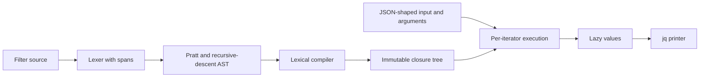
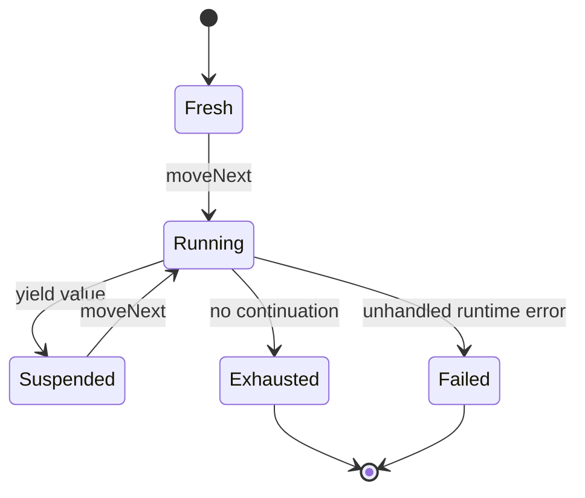
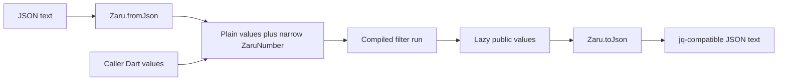

# Design

## Triage

| Trigger | Applies? | Evidence |
|---|---|---|
| T1 Components | Yes | `lib/zaru.dart:1-5` has no engine; M1 introduces lexer → AST → compiler → runtime/printer. |
| T2 State | Yes | Lazy iterators need fresh/running/suspended/exhausted/failed states and per-run lexical frames. |
| T3 Concurrency | No | Evaluation is synchronous; callers may interleave independent iterators, but no worker, timer, retry, or asynchronous pipeline is introduced. |
| T4 Boundaries | Yes | `docs/api.md:9-33` specifies a new public API; `test/conformance/fixtures.dart:19-64` preserves upstream raw numeric JSON. |
| T5 Volume | Yes | `range`, `repeat`, recursion, and comma/pipe products have no fixed result bound. |
| T6 Risk | Yes | Rounding untouched numeric IDs changes user data; `docs/adr/0002-evaluation-model.md:32-46` identifies this boundary. |

TIER: FULL

## Context

M0 is complete on main at `c56b9a8`. The library entrypoint is empty (`lib/zaru.dart:1-5`); the runner deliberately fails each fixture (`test/conformance/runner_test.dart:77-91`). There is no lexer, parser, compiler, or runtime in the inspected `lib/` tree. Existing pure-Dart fixture parsing and 27 VM/Chrome infrastructure tests are reusable. Scope is in proposal.md and its three delta specifications, not a CLI implementation.

The installed jq is 1.8.2. Reference invocations confirmed filter/value parameter composition, lazy `first`, false/null alternative filtering, partial results before catch, and `error(null)` raising an error whose catch value is null. Numeric reference output preserves `1.00`, renders `1e2` as `1E+2`, and prints computed `1.0 + 0` as `1`. Literal fidelity means jq-normalized spelling, not blindly copying every source byte.

The architecture index configured as `openspec/architecture.md` does not exist; both existing ADRs were read directly. No referenced stores are configured. The user explicitly approved the narrow exact-number type after the VM smoke check could not represent `12345678909876543212345` as an int and rounded it as a double.

## Decisions

### D1: Compile a real jq AST into lazy executable nodes

- **Choice:** Follow ADR 0001's source-span lexer, Pratt binding-power table, and recursive-descent structured productions. Keep interpolation lexical nesting explicit. Compile to ADR 0002's closure tree, resolving lexical bindings, arities, and label identities once. Lower jq-defined M1 helpers from pinned upstream definitions; implement only necessary native primitives.
- **Rejected:** A bytecode VM adds instruction design and dispatch before a measured need; interpreting source fragments on each run repeats parsing and makes compile errors lazy.
- **Reversal cost:** Medium. Internal node and closure representations are private; public errors and lazy stream ordering must remain stable.

### D2: Give every run and iterator its own execution state

- **Choice:** Compiled nodes and definition tables are immutable. Each iterator owns its lexical frames, continuation stack, branch positions, and reducer/foreach accumulators. Filter arguments capture the call site's environment; function bodies retain lexical definition scope and receive invocation input. `$param` sugar lowers to value binding rather than a different calling convention. Explicit continuation frames handle user recursion and tail calls without relying on host call-stack depth. Recursive descent uses a traversal stack, not a collected result list.
- **Rejected:** Mutable variables on the compiled filter would leak bindings between inputs and interleaved iterators. Eager list-based node evaluation cannot stop before an error in an unused branch.
- **Reversal cost:** Medium. Per-run ownership is binding; the private continuation mechanism can change without changing the API.

### D3: Use typed data errors and separate lexical control signals

- **Choice:** Compile errors have one-based line/column and source diagnostics. Runtime errors retain the actual jq error value, including null. Catch nodes intercept only runtime data errors. A unique lexical label identity travels in a private break signal and is caught only by its matching label. Do not turn host exceptions into successful/empty output or catch arbitrary Dart exceptions as jq errors.
- **Rejected:** A single exception class for compile failures, runtime data, and break would let `try` swallow lexical control flow and inflate expected-error fixture passes.
- **Reversal cost:** High for public error contracts; the distinction is required by pinned label/catch fixtures and the user brief.

### D4: Preserve exceptional numbers through an explicit narrow boundary

- **Choice:** Ordinary public values remain null/bool/num/String/List/Map. Add immutable `ZaruNumber` only when conversion to a native public number loses precision or jq-preserved literal form. Internally retain numeric origin (untouched decimal literal versus computed binary double) even for numbers that can be exposed plainly. On native-input ingestion, reconstruct the JSON literal represented by the native number's normalized spelling; values already rounded by callers cannot regain lost digits. Binary arithmetic uses jq's double conversion and produces computed numbers; unary negation instead preserves the exact literal coefficient, scale, and origin, including the large integer and long fraction at `jq.test:2224-2230`. Do not replace jq arithmetic with arbitrary-precision arithmetic.
  - **Evaluator comparison:** two untouched decimal operands compare as jq literals; comparisons involving a computed binary number follow jq's mixed/double conversion. Consequently `$n + 0 == $n` can be true after arithmetic rounding (`jq.test:2241-2247`).
  - **Conformance value comparison:** compare finite JSON numbers as exact decimal coefficient/exponent values independent of spelling, so `2` equals expected JSON `2.0`, but distinct large integer values never collapse through doubles. This is a test oracle, not the evaluator's mixed-origin equality.
  - **Text comparison:** assert jq serialization when the fixture observes text (for example `tojson` string outputs) or a dedicated printer case requires it; normalize no such strings. Equivalent raw numeric spellings alone do not turn an ordinary value fixture into a textual check.
- **Choice:** Add `Zaru.fromJson(String)` using the core JSON lexer/decoder to preserve numbers before they enter the engine. `Zaru.toJson` recognizes exceptional numbers recursively. The same classification is used on VM, dart2js, and wasm; classification must not depend on VM-only 64-bit int capacity. Native Dart inputs already rounded by callers cannot be repaired, and this boundary is documented rather than presented as a jq divergence.
- **Rejected:** A private wrapper that is converted back to num on `run()` loses the information before printing. A source-spelling expando on native numeric values conflates equal values with different origins and cannot reliably key native numbers. A text-only execution API would preserve precision but contradict the user's selected value API.
- **Reversal cost:** High: the public numeric boundary is durable. Approval is explicit in this conversation; parity probes against jq 1.8.2 and browser tests must settle precise normalization and classification rules before export.

### D5: Separate external variable declarations from per-run values

- **Choice:** Refine compilation as `Zaru.compile(String, {Set<String> variables = const {}})`. Lexical bindings and declared external names resolve at compile time; `run(input, args: ...)` supplies values per execution. Missing declared bindings produce a typed runtime argument error; undeclared references remain jq-style compile errors. There is no need to capture one run's argument values into the compiled filter.
- **Rejected:** Treating every unknown `$name` as an external variable would make jq's undefined-variable compile-error fixtures pass compilation. Capturing argument values only at compilation would undermine reuse with per-run `args`.
- **Reversal cost:** Medium. This is a refinement of the provided sketch, not a new query/context abstraction.

### D6: Replace artificial failures with strict execution, not broad skipping

- **Choice:** Keep the existing fixture parser, raw text, stable IDs, denominator, and report path. Invoke the real decoder/compiler/evaluator for every fixture. Use D4's distinct value-oracle and textual checks, preserving ordered duplicate outputs. Apply `%%FAIL` versus `%%FAIL IGNORE MSG` exactly. Keep a checked-in passed-ID floor and classify every `jq.test` case into the M1 acceptance set or explicit non-M1 dependencies; classification never removes a case from reporting.
- **Terminal policy:** pinned `src/jq_test.c:213-250` accepts an invalid `jq_next` after all expected outputs without distinguishing normal exhaustion from a terminal runtime error. Do not generalize that weakness into accepting arbitrary zaru failures. Record a stronger explicit runtime-expectation manifest for `jq.test:945`, `jq.test:949`, `jq.test:953`, and `jq.test:957`: empty output prefix followed by typed runtime error value `Cannot index array with string ("a")`. All four were observed with jq 1.8.2; stale comments mention `"c"` and are not directives. Every other evaluation case requires normal exhaustion unless a reviewed, reference-backed manifest entry explicitly records its expected prefix and runtime error value. Early failure before the expected prefix, extra outputs, wrong error type/value, or an unlisted error after an otherwise correct prefix fails. Preserve terminal kind/error in the report; host exceptions never qualify.
- **Rejected:** Excluding unsupported fixtures or comparing via rounded `jsonDecode` values manufactures compatibility. A count-only regression floor lets one new pass hide another lost pass.
- **Reversal cost:** Low for report internals; high for the meaning of passing. No automatic baseline decrease or fixture rewriting is permitted.

## Diagrams (FULL)

T1 — compile and execute components:

T2 — each independent iterator:

T4 — lossless numeric and public boundaries:

## State & Ownership (FULL)

| State | Owner (sole writer) | Lifetime | Invalidation / rebuild | Authoritative copy |
|---|---|---|---|---|
| Source/tokens/AST | One compilation | Compile call; source spans may be retained for errors | New compile call | Current compile input |
| Definitions and executable nodes | Compiler, then immutable | Compiled filter | New compile call | Compiled filter |
| Lexical frames and continuations | Individual iterator | Consumption or disposal by reachability | New iterator, never reuse from failed run | Iterator |
| Reduce/foreach accumulators | Individual iterator | Current reduction branch | Rebuilt per branch/run | Current execution frame |
| Collection literal templates and engine-created containers | Compiler/runtime at creation, then immutable | Reachable value lifetime | Each changed value creates new containers; immutable children may share | Engine-created List/Map nodes |
| Caller-owned collection references | Caller | Caller-defined | Not snapshotted or frozen by identity/pass-through | Caller input; mutation during iteration is outside the snapshot guarantee |
| Literal metadata | Decoder/compiler at creation, then immutable | Reachable value lifetime | Unary negation retains exact metadata; binary arithmetic produces computed origin | Internal numeric value, not a side table keyed by native num |
| Expected fixtures | Parser, then immutable | Conformance process | Reparse unchanged fixture bytes | Vendored corpus |
| Actual case outcomes | Runner | One suite invocation | New invocation | Execution observations |
| Passed-case floor and M1 classification | Reviewed source change | Across milestones | Explicit verified update; no lost IDs | Checked-in manifest |

## Failure & Visibility (FULL)

| Component | Fails / dies mid-operation → | Recovery | Retry safe? | Who finds out |
|---|---|---|---|---|
| Lexer/parser/compiler | No usable compiled filter is published | Correct source/declaration and recompile | Yes; compile has no effects | Caller receives typed location/diagnostic |
| JSON decoder | No partial public value is returned | Correct JSON and decode again | Yes | Caller receives a format failure with source position |
| Iterator | Earlier yields remain observed; unhandled jq error ends that iterator | Start another run; no implicit retry | Yes for pure M1 execution, but previously observed values are not retracted | Consumer sees typed runtime error |
| Label/catch handling | Only the matching language construct handles its signal | Resume remaining enclosing continuation | No retry mechanism | Observable stream/error matches jq |
| Printer | Unsupported caller data or invalid number cannot be silently substituted | Correct value | Yes | Caller receives explicit error, not fake JSON |
| Structural equality/order, recursive merge, repetition | A jq structural limit raises a typed, catchable runtime error before host-stack or excessive-size failure | Correct input/operation; start fresh iterator | Yes; input remains unchanged | Consumer/catch filter sees the pinned jq error value |
| Conformance comparator/report | Case fails on mismatch; report-write failure fails the run | Correct implementation or output path | Yes | Test output and machine-readable results; summary remains visible |

## Resource Bounds (FULL)

| Queue / buffer / cache / transfer | Bound | At the bound | Timeout | At 10x / 100x |
|---|---|---|---|---|
| Tokens/AST/compiled nodes | Proportional to finite source size | Host allocation failure is not converted to a jq success | No core timeout | Linear source growth; no duplicate source-fragment parsing |
| Generator scheduling | Active continuation/depth state, not total result count | Consumers request one next value; limit/first abandon unneeded continuations | No implicit timeout | Increasing finite range bounds alone does not increase buffered result count |
| Recursive descent | Active traversal depth | Explicit traversal frames; no list of all descendants | No implicit timeout | Deep trees use explicit frames rather than host recursion |
| User recursion | Active invocation/continuation depth | Tail calls reuse continuation positions; non-tail work retains necessary frames | No implicit timeout | Deep tail recursion must remain host-stack safe; unavoidable non-tail state scales with active depth |
| Array/object constructors and reducers | Actual constructed value or active accumulator sizes | Materialization is explicit jq semantics, not a hidden stream buffer | No implicit timeout | Large explicit arrays cost their actual size; do not promise bounded memory for `[range(...)]` |
| Number lexemes/decimal coefficients | Proportional to literal digits | No fabricated rounding to avoid size | No implicit timeout | Large literals scale with source digits; exact parsing must avoid exponent-sized zero padding |
| Structural equality and ordering | Root depth zero; reject descent beyond 10000, matching pinned `MAX_EQUAL_DEPTH`/`MAX_CMP_DEPTH` | Iterative work stack; typed `Equality check too deep` or `Comparison too deep` before host-stack failure | No implicit timeout | At 10x/100x nesting, fail at the same jq boundary rather than stack overflow |
| Recursive object multiplication/merge | Root depth zero; reject recursive merge beyond 10000, matching pinned `MAX_OBJECT_MERGE_DEPTH` | Iterative merge frames; typed `Object merge too deep`; original inputs unchanged | No implicit timeout | Boundary rejection independent of host recursion depth |
| String repetition | Reject resulting UTF-8 byte length >= 2147483639, matching `INT_MAX - sizeof(jvp_string)/2` with the pinned 16-byte string header | Count UTF-8 bytes without an encoded-copy buffer; checked/saturating length multiplication before allocation; typed `Repeat string result too long` | No implicit timeout | Oversize requests fail without allocating their requested result |
| Conformance streams | Compare incrementally per case | Stop at first mismatch or surplus output | Existing test-suite timeout policy | No extra 100x stream cache; finite expected data remains fixture-sized |
| Global caches, queues, background work | None introduced | Not applicable | Not applicable | No retained cross-run state growth |

## Flow & State Gaps (FULL)

- Partial consumption retains only that iterator's active frames; no `finally` effect, I/O handle, or worker is required for M1. Stopping does not evaluate discarded branches.
- Interleaved runs and independent iterators over one filter never share mutable frames. Caller mutation while an input is being consumed is not a snapshot guarantee; evaluation itself does not mutate inputs.
- Engine-created List/Map nodes are immutable before exposure, including engine-created descendants and yielded accumulators; attempted mutation raises Dart `UnsupportedError` and cannot alter a suspended frame or another run. Never expose mutable compile-time templates or an accumulator that will later be modified in place. Immutable engine values can be shared without per-yield deep copying. Caller-owned subtrees may remain shared by reference; mutating them is mutation of the input and follows the separately documented no-snapshot policy.
- A caught runtime error resumes the appropriate jq catch continuation with the error value; already yielded values are not replayed. Label breaks unwind to lexical identity rather than being caught as data errors.
- New iterators do not resume failed/exhausted iterators. There is no persisted execution state or restart protocol.
- No asynchronous events or out-of-order workers exist. Lexical continuations determine generator ordering; sibling expression products must be checked against jq, not guessed from Dart iteration order.
- No legacy engine callers need migration: M0 exports no executable API. Replace M0's runner failure path completely rather than leaving a compatibility switch or fake fallback.

## Mechanism Ledger (FULL)

| Mechanism | Built? | Why (harm nobody catches / expensive later) | Evidence that would change the call |
|---|---|---|---|
| Narrow numeric value and lossless JSON boundary | Yes | Public API is expensive to reverse; real upstream literals already lose digits in native num | User-authorized different boundary only |
| Lexical break identity and typed runtime errors | Yes | Catching the wrong control signal corrupts real core filter behavior | New upstream evidence about control semantics |
| Per-iterator frames and explicit recursive continuations | Yes | Lazy reuse/interleaving and deep recursion are core contracts | Equivalent stack-safe execution with the same contract |
| Selected-path execution mode | Internal seam only | ADR 0002 requires path-aware updates later; equal values cannot identify paths | Implement concrete path/update behavior with its later milestone, not speculative public wrappers now |
| Passed-ID floor | Yes | A count-only floor can silently lose a consumer-visible passing behavior | A stronger equivalent regression gate |
| Compiler cache, retries, global state | No | No observed need; immutable explicit reuse already avoids repeated compilation | Measured repeated-compilation problem |
| Bytecode VM, isolates, product MCP, benchmarks | No | Outside M1; no failure here needs them | Separate approved scope and evidence |
| Hard generator output cap | No | Would change jq semantics and break huge/unbounded lazy generators | Explicit caller-requested bounded consumption, not a hidden cap |

## Risks / Trade-offs

- [jq grammar precedence and generator Cartesian ordering are subtle] → pinned examples and reference jq probes at each uncertain boundary; never loosen output comparison.
- [Public numbers require more than plain num] → approved narrow type, lossless decoder/printer, and VM/dart2js/wasm parity probes; raw native decoding cannot restore lost digits.
- [A closure evaluator can accidentally become recursively eager] → explicit continuation ownership and prefix-consumption smokes with huge bounds and a late error.
- [Core-only acceptance classification can hide missing language features] → review every excluded `jq.test` ID's actual non-M1 dependencies, retain all in the total report, and require the entire core-only set.
- [Diagnostic text differs from jq C output] → preserve source spans and validate the actual `%%FAIL` policy; do not treat arbitrary compilation rejection as a pass.

## ADRs

- **In force, constraining this change:** ADR 0001 (parser), ADR 0002 (closure evaluation, paths, numeric fidelity).
- **To record during apply:** a superseding numeric-boundary ADR reflecting the user's approved public `ZaruNumber` exception and `Zaru.fromJson`; create the missing architecture index and link accepted decisions. ADR 0002's proposed plain-boundary precision error is not used as jq-compatible behavior. Existing accepted ADRs are not edited in place.

## Open Questions

None that block the selected approach. Exact token/error formatting and numeric normalization are implementation questions resolved against pinned jq 1.8.2; they do not authorize changes to the numeric fidelity or language contracts.
